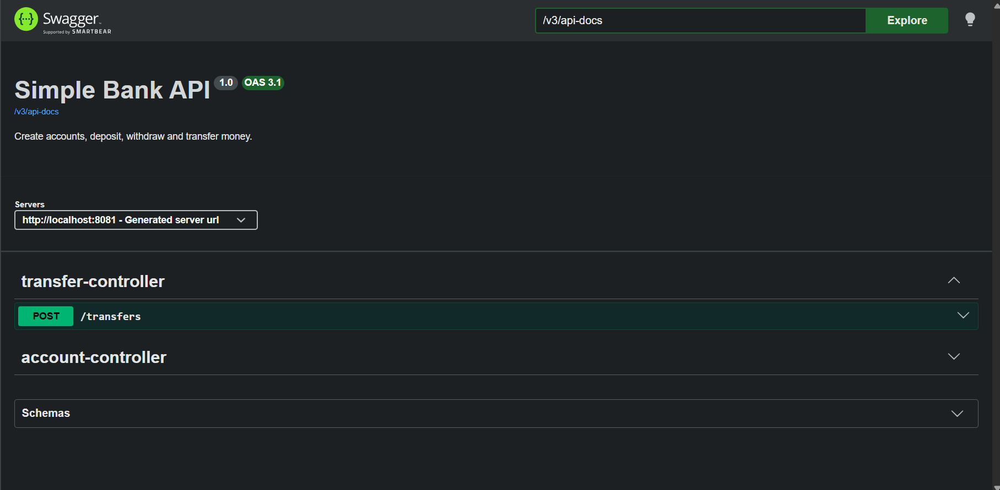

# Bank API Test Automation

A small banking application built with Spring Boot, with a multi-layer automated
test suite covering the API, the web UI and business-readable BDD scenarios.
Every push runs the full suite automatically on GitHub Actions.

## What it does
- Create accounts, deposit, withdraw and transfer money through a REST API
- Rejects invalid input (zero or negative amounts, blank names, missing fields)
- Returns clear JSON errors: 400 validation, 404 not found, 409 insufficient funds
- Transfers are transactional, so a failed transfer never loses money
- Simple web page (HTML + JavaScript) that uses the same API

## Tech stack
Java 21, Spring Boot 4, Spring Data JPA, H2 (in-memory), Maven, springdoc OpenAPI (Swagger UI), GitHub Actions

## API endpoints
| Method | Endpoint | Purpose | Success | Errors |
|--------|----------|---------|---------|--------|
| POST | `/accounts` | Create an account | 201 | 400 |
| GET | `/accounts/{id}` | Get an account | 200 | 404 |
| POST | `/accounts/{id}/deposit` | Deposit money | 200 | 400, 404 |
| POST | `/accounts/{id}/withdraw` | Withdraw money | 200 | 400, 404, 409 |
<<<<<<< HEAD
| POST | `/transfers` | Transfer between accounts | 200 | 400, 404, 409 |

## Testing approach
| Layer | Tool | Tests |
|-------|------|-------|
| Manual / exploratory | Postman | 9 positive and negative cases |
| API automation | REST Assured + JUnit | 8 |
| UI automation | Selenium WebDriver | 4 |
| BDD | Cucumber (Gherkin) | 3 scenarios |
| Code metrics | CK tool | 1 |

The full run executes 16 automated tests.

Highlights:
- Rollback test proving a failed transfer does not lose money
- Explicit waits instead of fixed sleeps in the UI tests
- Independent tests that create their own data
- Selenium runs headless in CI and in a normal browser locally
- HTML Cucumber report generated at `target/cucumber.html`

## Continuous integration
The workflow in `.github/workflows/ci.yml` runs on every push and pull request:
1. Sets up Java 21 and Chrome
2. Starts the application on port 8081
3. Runs `mvn test`
4. Uploads the Cucumber report as a build artifact

## How to run locally
1. Start the app: `mvn spring-boot:run` (runs on port 8081)
2. Open http://localhost:8081 for the web page
3. Open http://localhost:8081/swagger-ui.html for the interactive API docs (Swagger)
4. In a second terminal: `mvn test`
5. Cucumber report: `target/cucumber.html`

## Project structure
- `controller`, `service`, `repository`, `model`, `exception`: application layers
- `src/test/java/.../api`: REST Assured tests
- `src/test/java/.../ui`: Selenium tests
- `src/test/java/.../bdd` and `src/test/resources/features`: Cucumber steps and scenarios
- `ck-output`: output of the CK object-oriented metrics analysis
- `src/main/resources/static/index.html`: simple web page

## Author
Jeffrey Pearl Immanuel R
=======
| POST | `/transfers` |

## Screenshots
| CI pipeline | Cucumber report |
|---|---|
|  |  |

| Postman transfer | Web page |
|---|---|
|  |  |

| Swagger UI |
|---|
|  |
