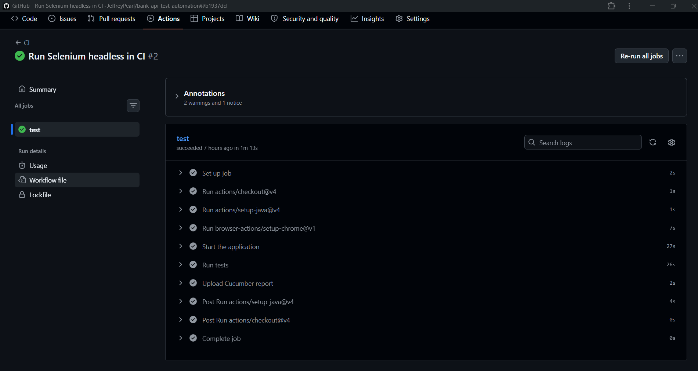
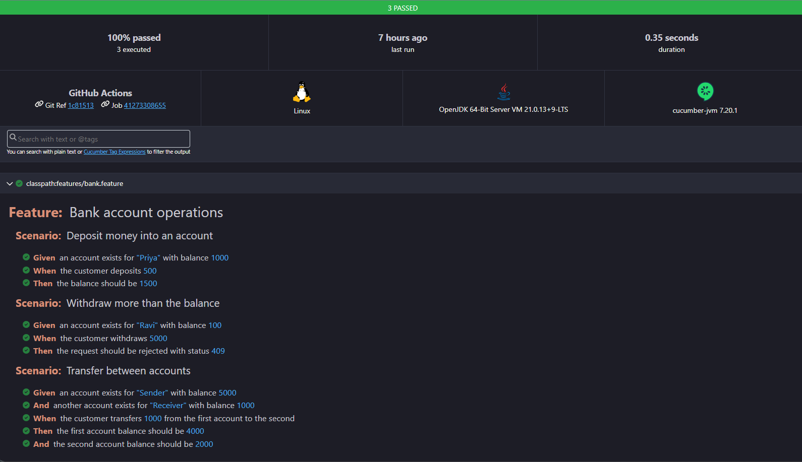
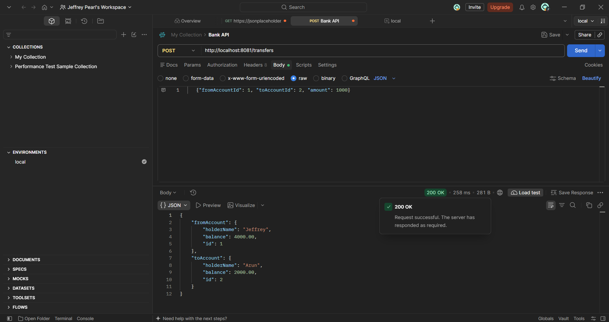
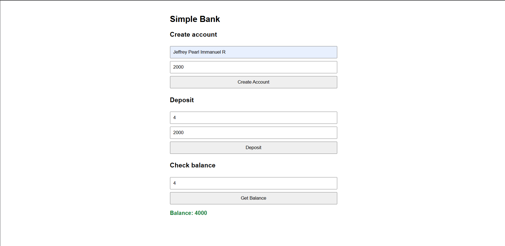

## Screenshots
| CI pipeline | Cucumber report |
|---|---|
|  |  |

| Postman transfer | Web page |
|---|---|
|  |  |

# Bank API Test Automation

A small banking application built with Spring Boot, with a multi-layer automated
test suite covering the API, the web UI and business-readable BDD scenarios.
Every push runs the full suite automatically on GitHub Actions.

## What it does
- Create accounts, deposit, withdraw and transfer money through a REST API
- Rejects invalid input (zero or negative amounts, blank names, missing fields)
- Returns clear JSON errors: 400 validation, 404 not found, 409 insufficient funds
- Transfers are transactional, so a failed transfer never loses money
- Simple web page (HTML + JavaScript) that uses the same API

## Tech stack
Java 21, Spring Boot 4, Spring Data JPA, H2 (in-memory), Maven, GitHub Actions

## API endpoints
| Method | Endpoint | Purpose | Success | Errors |
|--------|----------|---------|---------|--------|
| POST | `/accounts` | Create an account | 201 | 400 |
| GET | `/accounts/{id}` | Get an account | 200 | 404 |
| POST | `/accounts/{id}/deposit` | Deposit money | 200 | 400, 404 |
| POST | `/accounts/{id}/withdraw` | Withdraw money | 200 | 400, 404, 409 |
| POST | `/transfers` |
